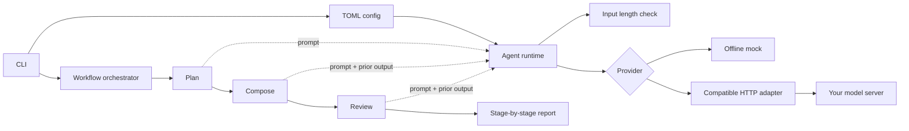
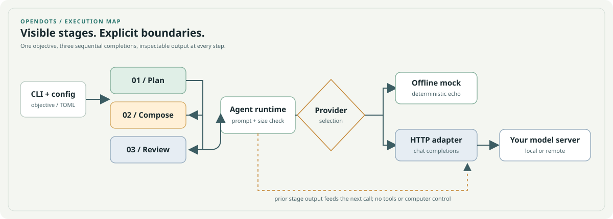

# OpenDots

**An independent, local-first runtime for configurable AI agents.** OpenDots takes the broad idea of a personal agent that helps move your goals forward and implements it as an open, inspectable project you can run with a model server of your choice.

> OpenDots is free and open-source software. The runtime adds no output-censorship layer of its own. The connected model and server may have their own safeguards, costs, licenses, and usage terms.

## What it does

- Runs against a local OpenAI-compatible inference server or a deterministic offline mock.
- Orchestrates an inspectable `plan → compose → review` workflow and returns each stage.
- Keeps prompts, endpoint settings, and input limits in a TOML file.
- Reads optional provider credentials from an environment variable, not from the config file.
- Has no third-party Python runtime dependencies.
- Starts with no tools enabled: the agent cannot execute shell commands, browse files, or take actions on your behalf.

OpenDots is a runtime, not a model distribution. You bring a model server that implements the chat-completions API and follow that model's license and acceptable-use terms.

## Quick start

Requires Python 3.11 or newer.

```bash
# Run these commands from your OpenDots checkout.
python -m venv .venv
```

Activate the virtual environment, then install the package:

```bash
# Linux or macOS
source .venv/bin/activate

# Windows PowerShell
# .venv\Scripts\Activate.ps1

python -m pip install -e .
```

Create `opendots.toml` from the included example and try the offline mock:

```bash
cp opendots.example.toml opendots.toml
opendots doctor
opendots run --message "Give me three names for a tiny garden robot."
opendots workflow --objective "Prepare a launch brief for a local bakery"
```

The mock echoes the input so you can verify installation and configuration without downloading a model or sending a network request. It is not an AI model. A workflow makes three mock calls and prints the plan, composition, and review stages separately.

## Connect a model server

Edit `opendots.toml` and set `provider.kind` to `"openai-compatible"`. Point `provider.base_url` at the server's API base URL and set the model identifier expected by that server. For a server requiring a bearer token, export the environment variable named by `provider.api_key_env`:

```bash
# Linux or macOS
export OPENDOTS_API_KEY="your-local-server-token"

# Windows PowerShell
# $env:OPENDOTS_API_KEY = "your-local-server-token"

opendots doctor
opendots run --message "Summarize the tradeoffs between SQLite and PostgreSQL."
```

Use a secret manager or your shell's private environment for real credentials. Do not commit secrets. Some local servers do not require an API key; in that case leave the variable unset.

## Configuration

| Key | Default | Purpose |
| --- | --- | --- |
| `agent.name` | required | Display name reported by `doctor` |
| `agent.system_prompt` | required | System message sent with each request |
| `agent.max_input_chars` | `12000` | Local upper bound for a user message |
| `provider.kind` | required | `mock` or `openai-compatible` |
| `provider.model` | required | Model identifier passed to the server |
| `provider.base_url` | `http://127.0.0.1:11434/v1` | OpenAI-compatible API base URL |
| `provider.api_key_env` | `OPENDOTS_API_KEY` | Environment variable containing an optional token |
| `provider.timeout_seconds` | `60` | HTTP request timeout |

See [`opendots.example.toml`](opendots.example.toml) for a complete configuration.

## Workflow architecture



Each stage is a model call, not an autonomous computer action. The workflow passes the objective and previous-stage output forward; it does not browse, execute shell commands, or claim to have performed the checks it recommends.



More detail: [architecture](docs/architecture.md), [providers](docs/providers.md), [security](docs/security.md), and [project scope](docs/project-scope.md).

## Commands

| Command | Behavior |
| --- | --- |
| `opendots doctor` | Validate local config; does not probe the network |
| `opendots run -m "..."` | Make one completion request |
| `opendots workflow -g "..."` | Run plan, compose, and review in sequence |
| `opendots workflow -g "..." --format json` | Print objective and all stage outputs as JSON |

Workflows make three sequential model requests. Check your server's quotas and data-handling policy before sending sensitive objectives.

## Development

```bash
python -m unittest discover -s tests -v
python -m opendots.cli --help
```

To run from a checkout without installing the package, set `PYTHONPATH=src` (PowerShell: `$env:PYTHONPATH = "src"`). CI runs the unit suite on Python 3.11 and 3.12.

## Project status

OpenDots is an early runtime. It supports single-message requests, an inspectable three-stage workflow, a mock provider, and the basic OpenAI-compatible chat-completions shape. It does not include conversation storage, streaming, tool execution, a web UI, model weights, or a security certification. See the [roadmap](docs/roadmap.md) before relying on future features.

## License

OpenDots is distributed under the MIT License. Third-party models and inference servers have their own licenses and terms; those do not change when used through OpenDots.