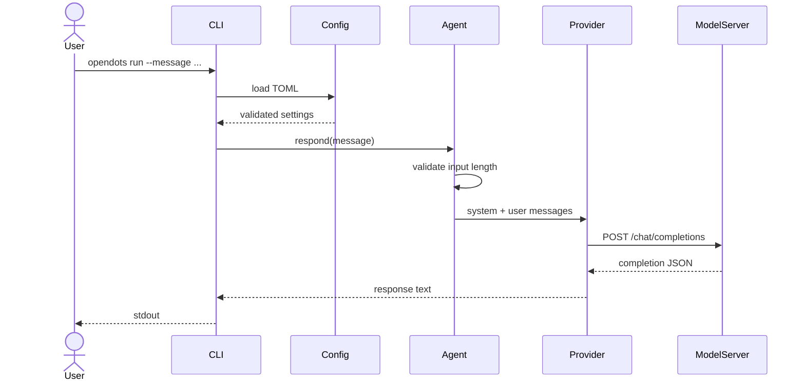

# Architecture

OpenDots is a synchronous agent runtime with both single-request and multi-stage entry points. Its module boundaries keep provider behavior replaceable and make each model call visible in the execution path.

## Request lifecycle

1. `cli` parses the command and loads the selected TOML file.
2. `config` validates required values and selects an optional API key from the process environment.
3. `runtime.Agent` checks the user message against the configured character limit.
4. The runtime creates a system/user message pair and delegates completion to a provider.
5. The provider returns text or raises a typed error; the CLI writes the result to stdout and errors to stderr.

## Workflow lifecycle

The `workflow` command performs three sequential completions: `plan`, `compose`, and `review`. Each request includes the original objective; the second and third requests also include the immediately preceding stage output. The CLI can render the complete stage trace as text or JSON. There is no hidden background worker, tool invocation, browser access, or computer control.

## Modules

| Module | Responsibility | Deliberately does not do |
| --- | --- | --- |
| `config` | Parse TOML, validate provider and limits | Fetch secrets from disk or network |
| `policy` | Enforce basic request shape and configured size | Claim to classify every unsafe request |
| `runtime` | Assemble messages and coordinate completion | Persist conversations or execute tools |
| `workflow` | Sequence fixed stages and retain outputs for display | Perform actions, run arbitrary stage definitions, or hide intermediate results |
| `providers` | Mock and HTTP chat-completions transport | Download or select model weights |
| `cli` | Human-facing commands and error reporting | Hide model/provider behavior from the operator |

## Extension points

New providers should expose a `complete(messages)` method and raise `ProviderError` with actionable context. Keep provider-specific options in configuration, avoid logging prompts or credentials by default, and add deterministic unit tests using a local fake HTTP server rather than live credentials.

The current interface is synchronous by design. Streaming, conversation history, and tools require explicit lifecycle and trust-boundary decisions; they should not be added as hidden side effects of the provider adapter.